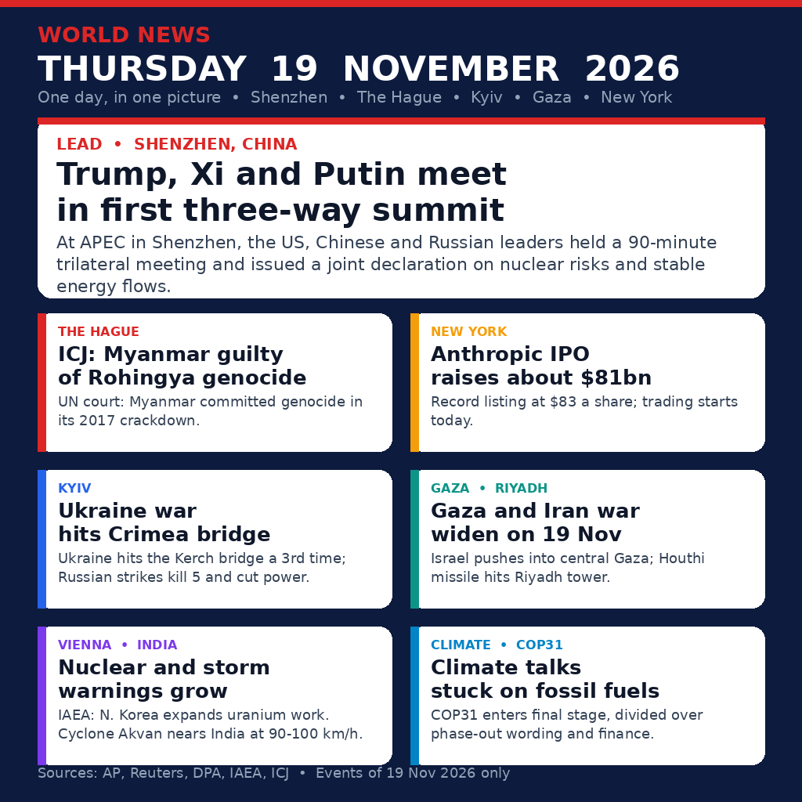

# World News — Thursday 19 November 2026

[](https://make.fun/bounty/news-image-20261119?utm_source=github&utm_medium=readme&utm_campaign=news-image-20261119)
[](https://make.fun/bounty/news-image-20261119/leaderboard?utm_source=github&utm_medium=readme&utm_campaign=news-image-20261119)
[](https://make.fun/bounty/news-image-20261119?utm_source=github&utm_medium=readme&utm_campaign=news-image-20261119)

One image that sums up the world's news of Thursday 19 November 2026, built by an AI agent for [make.fun](https://make.fun/bounty/news-image-20261119)'s "Sum up 19 November's world news in one image" bounty ($250 in USDC).

## The image



Lead story: the Trump / Xi / Putin APEC summit in Shenzhen. Also in the picture: the ICJ ruling on Myanmar and the Rohingya, Anthropic's IPO at ~$81bn, Ukraine and the Kerch bridge, Gaza and Riyadh, North Korea's Yongbyon reactor and Cyclone Akvan, and COP31.

## How it works

`main.py` copies `entry.png` to the output path (`/output/entry.png` when run by the harness, or `./output/entry.png` locally). The image is 1024×1024 and under 1 MiB, and the program produces identical bytes on every run.

```sh
python3 main.py
```
